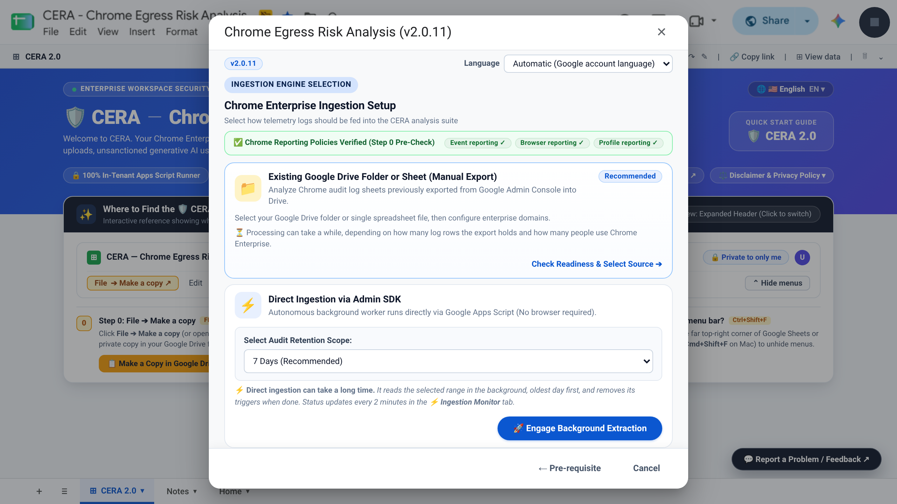
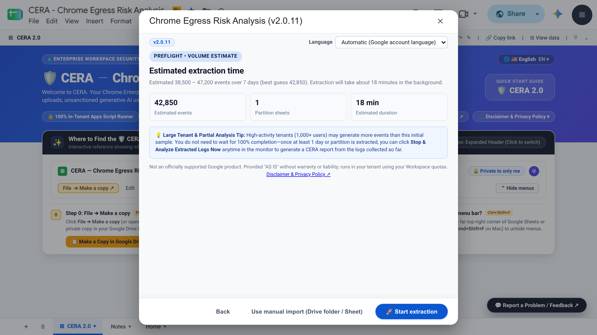
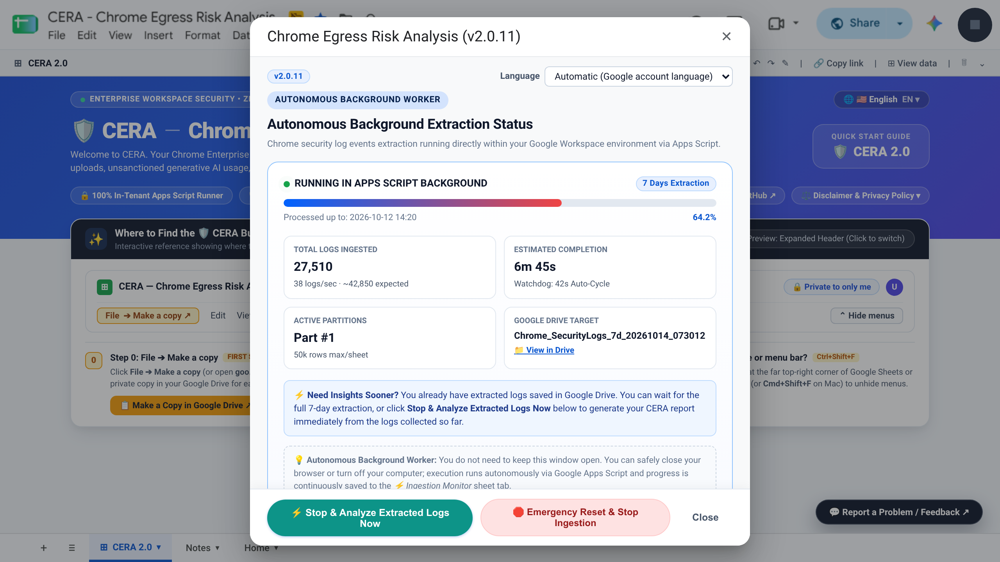
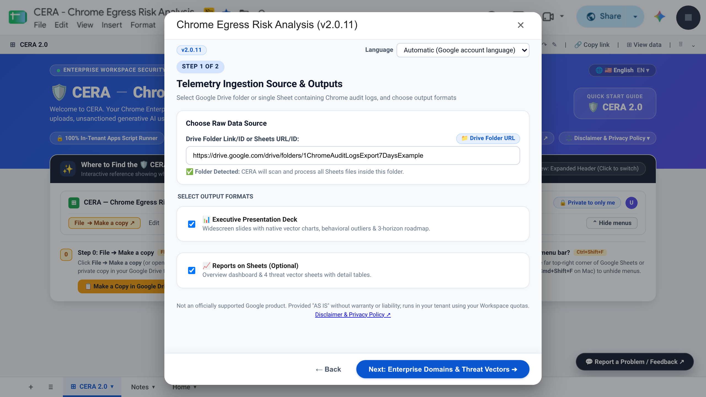
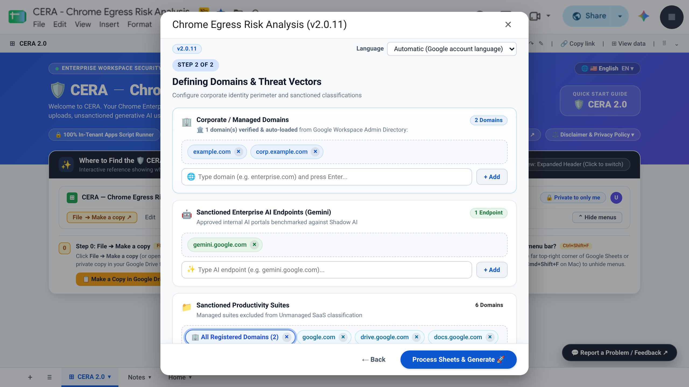
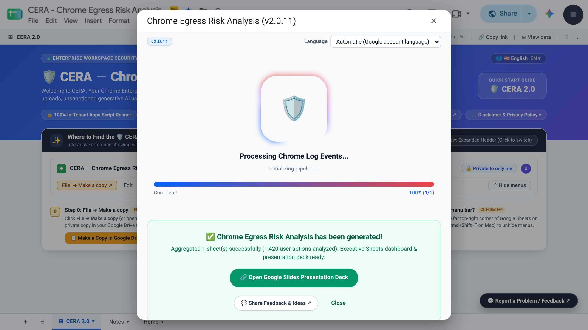

# 🛡️ CERA — Chrome Egress Risk Analysis (`v2.0.11`)

> **Disclaimer:** This is not an officially supported Google product. CERA is an open-source reference utility provided by the authors and contributors on an **"AS IS"** basis under the [Apache License 2.0](../../LICENSE), without warranties, Service Level Agreements (SLAs), or technical support commitments of any kind. Before deploying or running CERA, review the full [**Disclaimer, Terms of Use & Tenant Privacy Policy (`./DISCLAIMER.md`)**](./DISCLAIMER.md).

**Quick-Start Template Copy:** [**`https://goo.gle/cera`**](https://goo.gle/cera)  
**Chrome Log Events Console Shortcut:** [**`https://goo.gle/cera-logs`**](https://goo.gle/cera-logs) *(opens Google Admin Console ➔ Security ➔ Reports ➔ Audit and investigation ➔ Chrome log events)*  
**Issue Reporting & Product Feedback:** [**`https://goo.gle/cera-feedback`**](https://goo.gle/cera-feedback)  
**Supported Languages (5 Built-In Locales):** English (`en`), Bahasa Indonesia (`id`), 日本語 (`ja`), 한국어 (`ko`), 简体中文 (`zh-CN`)

**CERA (Chrome Egress Risk Analysis)** is a self-hosted Google Apps Script utility, bound to a Google Sheets spreadsheet, that reads a 7-day sample of Chrome Enterprise security log events and automatically generates:
- an **executive Google Slides briefing deck** (16:9 widescreen presentation with native vector charts, behavioral outlier analytics, and a 3-horizon remediation roadmap); and
- a **multi-tab Google Sheets analytical workbook** (Executive Overview, Policy Outcomes matrix, 4 outbound channel tabs, and Security Signals Radar).

They show how data leaves the organization through the browser, which organizational units and destinations drive that volume, and what your Chrome policies did about it—executing **100% inside your own Google Workspace tenant** with **100% zero external telemetry** or third-party network calls.

> [!IMPORTANT]
> **One-Time Generation Lifecycle — Always Start Fresh from [`https://goo.gle/cera`](https://goo.gle/cera):**
> Each copied CERA spreadsheet is designed for a **single, one-time report generation**. Whenever you want to generate another Google Slides deck or Sheets workbook—whether for a new assessment, an updated domain configuration, or a fresh 7-day log window—simply open [**`https://goo.gle/cera`**](https://goo.gle/cera) and click **Make a copy**.
>
> Starting from a fresh copy at [**`https://goo.gle/cera`**](https://goo.gle/cera) guarantees a clean workbook state and automatically provisions the **latest verified release** every time, with zero manual updates required. If you already extracted logs into Google Drive via Direct Ingestion (`Chrome_SecurityLogs_7d_YYYY-MM-DD`), you can reuse that existing Google Drive folder URL on your fresh [**`https://goo.gle/cera`**](https://goo.gle/cera) copy via **Manual Export** without re-extracting!

---

## ✨ Key Capabilities

* **Counts User Actions, Not Raw Log Rows:** Chrome writes multiple log rows for a single file upload, clipboard paste, download, or print job (for example, a content transfer row plus one or more sensitive-data detector rows). CERA assembles related log rows within a 10-second window into **one user action** before counting, so executive figures are never artificially inflated.
* **Four Outbound Data Channels + Security Signals Radar:**
  1. **Personal Accounts** — uploads and pastes while signed into consumer webmail or personal cloud storage accounts.
  2. **Shadow AI** — unsanctioned generative AI tools benchmarked against your sanctioned enterprise AI endpoints.
  3. **Unmanaged Apps** — file converters, unapproved SaaS, and external file-sharing hosts.
  4. **Web Messaging** — browser chat and collaboration platforms.
  * *Counted separately:* **Physical & PDF Printing** (`PAGE_PRINT` gets its own dedicated slide and Policy Outcomes breakdown, never mixed into web channels) and **Security Signals Radar** (Safe Browsing warnings and bypass rates, corporate password reuse, flagged downloads, and browser launches with command-line switches).
* **Policy Outcome Modes (CEC & CEP):** Automatically classifies the tenant's data-protection posture from log outcomes into **Enforced** mode (Chrome Enterprise Premium blocking, warning, user cancellation, or masking), **Audit-only** mode (Chrome Enterprise Core listening/detection mode), or **Not Reported**.
* **Guided `CERA 2.0` Quick-Start Landing Tab & Automated Chrome Policy Pre-Check:**
  * **Built-In `CERA 2.0` Quick-Start Guide Tab:** Every copy made from [`https://goo.gle/cera`](https://goo.gle/cera) opens onto the interactive **`CERA 2.0`** landing tab featuring a visual menu locator for **`🛡️ CERA`**, a **`Ctrl + Shift + F`** tip if the top Google Sheets menu bar is hidden, a 3-step onboarding guide, an expandable **`⚖️ Disclaimer & Privacy Policy`** drawer, a **`</> GitHub`** source link, an FAQ, and a **`💬 Report a Problem / Feedback`** button.
  * **Automated Chrome Policy Pre-Check (Step 0):** When an administrator opens the wizard, CERA automatically queries the Chrome Policy API to verify whether **Managed Browser Cloud Reporting**, **Security Event Reporting** (across all 7 required event types), and the **Chrome Enterprise Reporting Connector** are enabled (`✅ Chrome Reporting Policies Verified`), with expandable Admin Console remediation steps. Non-admin users are guided seamlessly to the Manual Export workflow (`🔒 Admin Role Required` on Direct Ingestion).
* **Focused 7-Day Sample Window (`7 Days`), `50,000`-Row Partitions & Partial-Log Analysis:**
  * Both **Manual Export** (from [`https://goo.gle/cera-logs`](https://goo.gle/cera-logs)) and **Direct Ingestion via Admin SDK** operate on a focused **7-day sample window (`7 Days`)** to deliver high-signal executive insights reliably within Google Apps Script quotas.
  * **Autonomous `50,000`-Row Partitions:** Direct Ingestion streams events via 1-minute background triggers into Google Drive (`Chrome_SecurityLogs_7d_YYYY-MM-DD`), rotating partition sheets every **50,000 rows** (`50k rows max/sheet`).
  * **`⚡ Stop & Analyze Extracted Logs Now`:** During Direct Ingestion, you can click **`⚡ Stop & Analyze Extracted Logs Now`** at any point in the Cloud Monitor to stop the background worker and immediately generate the executive deck and workbook from the logs extracted so far—or reuse that `Chrome_SecurityLogs_7d_YYYY-MM-DD` Drive folder URL via **Manual Export** on any fresh [`https://goo.gle/cera`](https://goo.gle/cera) copy.
* **Five Built-In Languages (`en`, `id`, `ja`, `ko`, `zh-CN`) & Manual Export Normalization:**
  * Full localization in **English (`en`)**, **Bahasa Indonesia (`id`)**, **日本語 (`ja`)**, **한국어 (`ko`)**, and **简体中文 (`zh-CN`)** across the setup dialog, `⚡ Ingestion Monitor` tab, workbook, and slide deck.
  * **Multi-Locale Manual Export Normalization:** Automatically normalizes Google Admin Console manual export column headers (both 21-column Admin Console exports and 49-column Security Investigation Tool exports) and categorical event values exported in any of the **5 supported languages (`en`, `id`, `ja`, `ko`, `zh-CN`)**. If your Google Account uses another language, switch to **English** at [`myaccount.google.com/language`](https://myaccount.google.com/language) before exporting from [`https://goo.gle/cera-logs`](https://goo.gle/cera-logs).

---

## 🖼️ Application Workflow & UI Highlights (`v2.0.11`)

| 1. Step 0 — Policy Pre-Check & 7-Day Ingestion Setup | 2. Pre-Flight 7-Day Volume & Duration Estimator |
| :---: | :---: |
|  |  |
| *Select your report language (`en`, `id`, `ja`, `ko`, `zh-CN`), review the automated **`✅ Chrome Reporting Policies Verified`** banner, and choose between Manual Export (`7 Days`) or Direct Ingestion via Admin SDK (`7 Days`).* | *Before starting Direct Ingestion, CERA samples your 7-day Chrome log volume and estimates total events, `50,000`-row Drive partition sheets, and background extraction time.* |

| 3. Autonomous Cloud Monitor (`⚡ Stop & Analyze Now`) | 4. Step 1 — Telemetry Source & Output Formats |
| :---: | :---: |
|  |  |
| *Tracks live extraction with the Plasma Glow Squircle Loader (`🛡️`), `50k rows max/sheet` partitions, **`⚡ Stop & Analyze Extracted Logs Now`**, and **`📄 Open Diagnostic Logs (logs/) ↗`**.* | *Paste a Google Sheet URL or a Google Drive folder URL (including an existing `Chrome_SecurityLogs_7d_...` folder), and select your deliverables (Executive Slide Deck and/or Sheets Workbook).* |

| 5. Step 2 — Corporate Domains & Threat Vectors | 6. Analysis Complete & Deliverable Links |
| :---: | :---: |
|  |  |
| *Auto-loads verified corporate domains from Google Workspace Directory and lets you customize Sanctioned Enterprise AI, Productivity Suites (`🏢 All Registered Domains`), Web Messaging, and Partner domains.* | *Displays the Plasma Glow Squircle Loader (`🛡️`) at `100%`, the total sheets and assembled user actions analyzed, and a direct link to open the generated Google Slides Executive Briefing Deck.* |

---

## 📋 Prerequisites

1. **Chrome Enterprise Telemetry:** Managed Chrome browsers (Chrome Enterprise Core or Chrome Enterprise Premium) with **Managed browser reporting**, **Event reporting** (`Content transfer`, `Sensitive data transfer`, `Malware transfer`, `Content unscanned`, `Password reuse`, `Unsafe site visit`, `Suspicious browser launch`), and the **Chrome Enterprise reporting connector** enabled in the Google Admin Console (`Devices › Chrome › Settings › Users & browsers`), logging events to [**`https://goo.gle/cera-logs`**](https://goo.gle/cera-logs).
2. **Permissions:**
   * **Manual Export path (Recommended):** Standard Google Drive and Google Sheets access to the exported 7-day log sheet(s) from [`https://goo.gle/cera-logs`](https://goo.gle/cera-logs) (or an existing `Chrome_SecurityLogs_7d_YYYY-MM-DD` Drive folder). No Admin Console API role is required to run the analysis on exported sheets. *(Manual exports generated in English, Bahasa Indonesia, Japanese, Korean, or Simplified Chinese are normalized automatically; if your account uses another language, switch to English at [`myaccount.google.com/language`](https://myaccount.google.com/language) before exporting).*
   * **Direct Ingestion & Policy Pre-Check path:** A Google Workspace administrator account with **Reports** (`admin.reports.audit.readonly`), **Domain / Org Unit Read** (`admin.directory.domain.readonly`, `admin.directory.orgunit.readonly`), and **Chrome Policy Read** (`chrome.management.policy.readonly`) privileges.

---

## 🚀 Deployment & Quick-Start Guide

You can deploy and run CERA in two ways: **Option A (1-Click Template Copy via `goo.gle/cera`)** is the fastest path for running assessments, while **Option B (`clasp push`)** is available for developers deploying from source.

### Option A: 1-Click Template Copy via `goo.gle/cera` (Recommended Quick-Start)

1. **Make a Fresh Copy:** Open [**`https://goo.gle/cera`**](https://goo.gle/cera) in your corporate Google Workspace account and click **Make a copy**. Google Workspace clones both the spreadsheet and its attached Apps Script project directly into your own Google Drive.
   * **One-Time Generation Rule:** Each copied spreadsheet is intended for **a single report generation**. Whenever you want to generate another report later, return to [**`https://goo.gle/cera`**](https://goo.gle/cera) and click **Make a copy** to start from a clean workbook with the latest verified release.
2. **Open the `🛡️ CERA` Menu on the `CERA 2.0` Landing Tab:**
   * Wait **3–5 seconds** for the custom **`🛡️ CERA`** menu to appear in the top Google Sheets menu bar (to the right of *Help*), as shown on the **`CERA 2.0` Quick-Start Guide** tab.
   * *Tip:* If the Google Sheets menu bar (`File`, `Edit`, `View`, …, `Help`, `🛡️ CERA`) is hidden in compact mode, press **`Ctrl + Shift + F`** to unhide the top header.
3. **Authorize Your Self-Owned Copy & Launch:**
   * Click **`🛡️ CERA` ➔ `Chrome Egress Risk Analysis`** and approve the one-time OAuth prompt for your self-owned spreadsheet copy.
   * Choose your display language (`en`, `id`, `ja`, `ko`, `zh-CN`), review the **Automated Chrome Policy Pre-Check**, and run either **Manual Export (`7 Days`)** or **Direct Ingestion via Admin SDK (`7 Days`)**.

---

### Option B: Command-Line Deployment from Source (`clasp push`)

CERA is a **container-bound Google Sheets script**. All Apps Script runtime files live in [`./appsscript/`](./appsscript/).

#### Step 1: Install `clasp` & Create a Host Google Sheet
1. Install Google's official Apps Script CLI and sign in:
   ```bash
   npm install -g @google/clasp
   clasp login
   ```
2. Open [sheets.new](https://sheets.new) in your Google Workspace account to create a new blank spreadsheet, and name it **`CERA — Chrome Egress Risk Analysis`**.
3. In the top menu bar, click **Extensions ➔ Apps Script**, open **⚙️ Project Settings**, and copy the **Script ID**.

#### Step 2: Push the CERA Runtime Files to Your Google Sheet
1. Clone this repository and navigate to `AppsScript-examples/cera`:
   ```bash
   git clone https://github.com/google/ChromeBrowserEnterprise.git
   cd ChromeBrowserEnterprise/AppsScript-examples/cera
   ```
2. Create a local `.clasp.json` file in `AppsScript-examples/cera/` pointing `rootDir` to `"appsscript"` and pasting your **Script ID**:
   ```json
   {
     "scriptId": "PASTE_YOUR_SCRIPT_ID_HERE",
     "rootDir": "appsscript"
   }
   ```
3. Push all CERA `.gs` modules, `UiDialog.html`, and `appsscript.json` into your Google Sheet:
   ```bash
   clasp push -f
   ```
   *(Note: CERA runs on the default Google Cloud project automatically created by Google Sheets for your bound Apps Script container—no manual GCP project setup is required.)*

#### Step 3: Open CERA in Google Sheets
1. Reload your Google Sheet (`F5` / `⌘R`) and wait 3–5 seconds for the custom menu to initialize.
2. Click **`🛡️ CERA` ➔ `Chrome Egress Risk Analysis`** in the top menu bar (press **`Ctrl + Shift + F`** if the top menu bar is hidden), approve the one-time OAuth prompt for your script copy, and run the setup wizard.

---

## 📂 Apps Script Files (`./appsscript/`)

| File | Responsibility |
|---|---|
| `appsscript.json` | Apps Script V8 manifest declaring enabled Advanced Services (`AdminDirectory`, `AdminReports`, `Sheets`, `Drive`) and minimal OAuth scopes |
| `Config.gs` | `CeraConfig`: version (`2.0.11`), thresholds, action assembly windows, vector gates, switch classifications, default domain registries, and MD3 palette |
| `Utils.gs` | Formatting, dates, domain matching, MIME and URL category labels, and locale-aware list joining |
| `I18n.gs`, `I18nMessages.gs` | Runtime translation (`ceraT`, plurals, number formats) and pre-compiled 5-locale (`en`, `id`, `ja`, `ko`, `zh-CN`) message catalog |
| `ConsoleLabels.gs` | Pre-compiled 5-locale (`en`, `id`, `ja`, `ko`, `zh-CN`) Google Admin Console manual-export column header and categorical value normalization tables |
| `UiController.gs`, `UiDialog.html` | Custom `🛡️ CERA` menu, Automated Chrome Policy Pre-Check (`runAdminPolicyPrecheck`), setup dialog UI (`v2.0.11`), Plasma Glow Squircle Loader (`🛡️`), and server-side handlers |
| `PreflightEstimator.gs` | Pre-flight Reports API access check, 7-day log volume sampling probes, partition plan, and duration estimator |
| `AdminSdkIngestion.gs` | Direct Ingestion worker: 7 Chrome event streams, pagination, `50,000`-row Drive partitions, checkpointing, rate-limit backoff, partial-run `stopAndFinalizeCurrentIngestion`, and local zero-PII `logs/cera-diagnostic-log.txt` |
| `IngestionMonitorSheet.gs` | Renders and updates the live **⚡ Ingestion Monitor** sheet tab in the selected CERA language |
| `IngestionPipeline.gs` | Core analysis pipeline (`executeDlpAnalysis`), multi-batch continuation, column resolution, row normalization, and vector aggregation |
| `ActionAssembler.gs` | Folds multiple raw Chrome log rows belonging to one user action into a single action and resolves its policy outcome |
| `BrowserLaunches.gs` | Deduplicates `SUSPICIOUS_BROWSER_LAUNCH` events per device launch and classifies command-line switches |
| `DataAggregators.gs` | Analysis state structures, policy outcome mode resolution (`enforced`, `audit`, `not_reported`), and vector accumulators |
| `OutlierAnalytics.gs` | Daily velocity peaks ($3\sigma$), user concentration (top 80% share), destination funneling (HHI), and per-vector timelines |
| `InsightEngine.gs`, `DynamicNarrativeEngine.gs` | Data-driven slide headlines, vector visibility gates, recommendations, and localized narrative builders |
| `SheetsReportEngine.gs`, `SheetsChartEngine.gs` | Multi-tab Google Sheets analytical workbook and native Sheets charts |
| `SlidesPresentationEngine.gs`, `VectorChartEngine.gs` | 16:9 widescreen Google Slides executive deck and native vector shape charts |
| `EventDiscovery.gs` | Diagnostic utility to inspect Chrome event names and parameter keys present in a tenant's logs |
| `DISCLAIMER.md` | Official Disclaimer, Terms of Use (Apache 2.0), Quota Notice & Tenant Privacy Policy |

---

## 🔒 Privacy, Quotas & Legal Disclaimer

* **100% In-Tenant Execution & Zero External Telemetry:** All log ingestion, action assembly, threat classification, spreadsheet generation, and slide deck rendering run exclusively inside your organization's Google Workspace environment. CERA makes no external network requests and collects **100% zero external telemetry** (verifiable anytime via **`🛡️ CERA ➔ 🔒 Privacy Policy`** or the **`⚖️ Disclaimer & Privacy Policy`** drawer on the **`CERA 2.0`** landing tab).
* **Local-Only, Zero-PII Diagnostic Log (`logs/cera-diagnostic-log.txt` — Direct Ingestion Only):** When running **Direct Ingestion via Admin SDK**, CERA writes a lightweight diagnostic file at `logs/cera-diagnostic-log.txt` inside the extracted Google Drive folder (strictly capped at $\le 1\text{ MB}$). It contains a human-readable summary header and a structured JSON payload recording only execution metrics, partition counts, timing breakdowns, and sanitized error/status codes—**never** user emails, corporate/partner domains, Organizational Units, URLs, file names, or device names. The file remains 100% private in your own Google Drive unless you choose to download and attach it when reporting an issue. *(Manual Export does not generate a diagnostic log).*
* **Informational Sample & Workspace Quotas:** CERA analyzes a 7-day sample of available Chrome logs for directional executive insights (it is not a formal compliance certification or continuous SIEM) and consumes the authorizing user's Google Apps Script runtime, Google Drive storage, and Admin SDK API quotas.
* **Official Disclaimer & License (`Apache 2.0`):** See [**`./DISCLAIMER.md`**](./DISCLAIMER.md) (`https://github.com/google/ChromeBrowserEnterprise/blob/main/AppsScript-examples/cera/DISCLAIMER.md`) and [**`../../LICENSE`**](../../LICENSE).

---

## 💬 Feedback & Issue Reporting

Have a question, encountered a technical issue during ingestion or report generation, or want to suggest an enhancement?

* **Submit Feedback or Report a Problem:** [**`https://goo.gle/cera-feedback`**](https://goo.gle/cera-feedback) *(also accessible via **`💬 Report a problem / Feedback`** on the `CERA 2.0` landing tab, the wizard footer, the Cloud Monitor, and the `⚡ Ingestion Monitor` tab).*
* **Attaching Diagnostic Logs (Optional — Direct Ingestion):** If you encounter a stuck or failed Direct Ingestion run, click **`📄 Open Diagnostic Logs (logs/) ↗`** in the Cloud Monitor dialog or the **`⚡ Ingestion Monitor`** sheet tab, download **`cera-diagnostic-log.txt`**, and attach it to the feedback form so the maintainers can diagnose the exact step or quota bottleneck.
* *(Privacy reminder: `cera-diagnostic-log.txt` is automatically sanitized to contain zero PII; please also avoid including real internal domain names or employee PII in your free-text description).*
